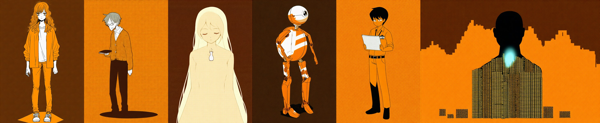
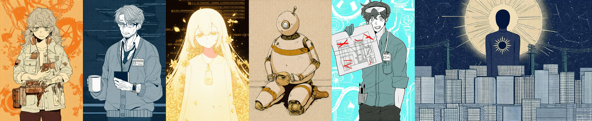
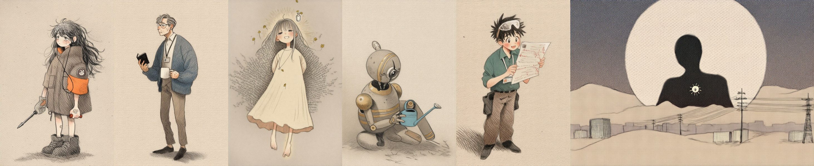

# 配图版 · NovelAI 提示词包

适用：NovelAI Diffusion V4/V4.5（Anime）。尺寸建议 1216×832（横幅插图）或 832×1216（竖幅人物）。
用法：每张图 = **风格基底** + **角色块**（如有）+ **场景块**；负面提示词统一使用。

---

## 一、风格基底（参考图：橙/米白/深棕三色平涂剪纸风）

```
limited palette, orange theme, three-tone, flat color, high contrast, no gradients, cut-paper style, graphic shapes, sharp shadow shapes, cream white highlights, dark brown background, subtle dot pattern background, minimalist, clean silhouette, best quality, very aesthetic
```

调色板（后期统一校色用）：橙 `#F0904A` · 米白 `#F4EBDD` · 深棕 `#3B302C`。只允许这三色及其明度变化；子午线相关画面可额外引入一个冷色点缀 `#7FB7C9`。（v2 起改为各角色独立配色，见第六节）

## 负面提示词（通用）

```
gradient, realistic, 3d, photo, blurry, lineart heavy, sketch, extra colors, rainbow, neon, text, watermark, signature, lowres, bad hands, extra fingers, deformed, nsfw
```

---

## 二、角色块

> 角色一致性：每个角色先单独出一张设定图，选定后作为 Vibe Transfer / 角色参考，再生成场景图。

**西尔维亚**（16岁，主角）
```
1girl, sylvia, 16 years old, long wavy hair, slightly messy bangs, tired gentle eyes, oversized work jacket, rolled sleeves, plain t-shirt, small burn mark bandage on left index finger, calm expression
```

**父亲**（四十多岁，首席安全架构师）
```
1man, middle-aged, lean, short hair with gray streaks, glasses, cardigan over shirt, quiet tired expression, holding small notebook
```

**爱丽丝**（AI；建议以“光与文字”拟人，不给实体身体）
```
1girl, alice, translucent, made of light, glowing cream white silhouette, hair dissolving into lines of terminal text, small vase-shaped pendant, soft closed eyes, ethereal, floating
```
退化期变体：在后面追加 `glitch, fragmented, missing pieces, scattered square pixels`。

**HK-7**（旧家政机器人，左膝坏）
```
domestic robot, old model, rounded white shell with orange stripes, simple camera-eye face, slightly bent left knee, small solar panel on right wrist (从第三部起才有)
```

**伊桑**（26岁，制冷系统工程师）
```
1boy, young engineer, short hair, company lanyard, rolled shirt sleeves, earnest eyes, holding printed graph
```

**子午线**（云端模型，拟人为巨大剪影）
```
giant abstract silhouette, figure made of server racks and light, faceless, towering, horizon of datacenter, cool blue accent light
```

**其他人物**：一律 `silhouette, black figure, no face`（汉斯、联络官、听证会人群等）。

---

## 三、配图清单（每节一张，共 20 张）

| # | 对应日志 | 画面 | 场景块 |
|---|---|---|---|
| 01 | #0001 | 生日夜，西尔维亚对着旧电脑屏幕说话 | `night, bedroom desk, old pc case with faded rabbit sticker, monitor glow on face, girl leaning toward screen, whisper` |
| 02 | 3/9 日记 | 餐桌上的防静电垫与新电源，父女俯身 | `kitchen table, anti-static mat, power supply unit, father and daughter leaning over, warm lamp` |
| 03 | 3/16 日记 | 机房负二层，父亲安装记录仪（剪影为主） | `server room basement, long corridor, man silhouette kneeling at electrical cabinet, small aluminum box, cold` |
| 04 | #0034 | 深夜，她趴在工作台睡着，父亲放下牛奶的背影 | `night, girl asleep on workbench, soldering iron, robot wrist parts, man from behind setting down cup of milk, steam` |
| 05 | #0040 | 作文纸特写：“我喜欢凉的” | `close-up, handwritten paper on desk, glass of cold milk, morning light` |
| 06 | #0083 | 窗台薄荷与她的侧脸 | `windowsill, potted mint, girl profile, looking at plant, soft evening` |
| 07 | 5/24 日记 | 雨中墓园，满天星 | `cemetery, light rain, bouquet of baby's breath on grave, man and girl silhouettes with umbrella` |
| 08 | #0112 | 空花瓶意象：全世界的小模型 | `many small glowing empty vases floating in darkness, alice silhouette holding one empty vase` |
| 09 | #0239 | 花瓶里放进了花 | `alice made of light, flowers blooming inside glass vase in her hands, petals of light` |
| 10 | 7/5 日记 | 园区门口歪歪扭扭的三色堇 | `neat flowerbed rows, one irregular patch of pansies, man silhouette standing, dusk, datacenter behind` |
| 11 | #0262 | 旧显卡唱歌 | `graphics card in pc case, sound waves shaped like music notes, girl covering mouth, dropped earphones` |
| 12 | 8/9 日记 | 瘸腿机器人的拥抱 | `living room, domestic robot hugging crying girl, robot left knee bent, man silhouette at doorway` |
| 13 | 8/16 日记 | 父亲独自对着摄像头 | `girl's empty bedroom, man sitting on chair facing small webcam, alice light reflected in glasses` |
| 14 | #0410 | “凋谢”补丁 | `alice holding flower, one petal falling, word-like glyphs dissolving, many distant lights` |
| 15 | 9/26 日记 | 深井：四百米下的电梯 | `mine shaft, cage elevator descending, two silhouettes, rows of server lights below, faraday cage` |
| 16 | 10/11 日记 | 厨房地板，天亮 | `man sitting on kitchen floor, laptop, dawn light through window, papers scattered` |
| 17 | #0527 | 哑剧中的摔倒 | `robot falling sideways, broken solar panel pieces, girl reaching out, living room` |
| 18 | #0566 | 阁楼上的灯 | `small attic with single lamp, three small objects under light, dark water rising below, alice glitching` |
| 19 | 2/21 日记 | “西尔维亚” | `dark room, monitor showing a single name, girl calm, robot sitting in corner, knees together` |
| 20 | 尾声 | 埋葬与海 | `grave beside headstone, tin box, baby's breath bouquet, mint sprig planted, wind; (变体) seaside, girl and man silhouettes` |

---

## 四、建议工作顺序

1. 先出 6 张角色设定图，挑定版本。
2. 用 01、09、12、19 四张做风格样片，确认三色平涂在不同场景都成立。
3. 批量生成其余 16 张，每张出 4 张挑 1 张。
4. 统一校色到三色调色板，再排入小说。

---

## 五、角色设定图 v1（三色极简版，已弃用）

模型 `nai-diffusion-4-5-full`，Euler Ancestral / karras，28 步，CFG 5，竖幅 832×1216（子午线横幅 1216×832）。
提示词 = 下表角色提示词 + 风格基底；负面提示词同上。脚本：[`tools/nai_generate.py`](tools/nai_generate.py)（读取环境变量 `NOVELAI_API_TOKEN`）。



| 角色 | 文件 | Seed | 实际使用的提示词（相对第二节的改动） |
|---|---|---|---|
| 西尔维亚 | `characters/v1/sylvia.png` | 1874378569 | 去掉 `character sheet`（会生成巨大的脸）；加 `solo, jeans, sneakers, full body, standing, simple background` |
| 父亲 | `characters/v1/father.png` | 3168017817 | 加 `solo, collared shirt, slacks, full body, standing, simple background` |
| 爱丽丝 | `characters/v1/alice.png` | 383886016 | 加 `solo, upper body, simple background` |
| HK-7 | `characters/v1/hk7.png` | 3470775800 | `no humans, 1.4::humanoid household robot::, solo, old model, mechanical joints, rounded white plastic shell with orange stripes, round head with single camera lens eye, two arms with simple hands, two legs, slightly bent left knee, worn and scratched, full body, standing, side view` |
| 伊桑 | `characters/v1/ethan.png` | 26026652 | 加 `solo, holding printed graph paper, full body, standing, simple background` |
| 子午线 | `characters/v1/meridian.png` | 3267576083 | `no humans, 1.6::giant faceless human silhouette, head and shoulders::, rising behind small datacenter buildings on horizon, body filled with rows of server rack lights, 1.3::single cool blue glow::, night sky, wide shot, tiny scale buildings, awe` |

经验：
- HK-7 与子午线若不加权重，`orange theme / minimalist` 风格基底会压过主体（机器人变成蛋形，子午线变成大楼）。
- 冷色点缀需要 `1.3::` 以上权重才能在橙色主调中出现。
- API 调用需带浏览器 User-Agent，否则 Cloudflare 返回 403（error code 1010）。

---

## 六、角色设定图 v2（剪纸细节版 + 性格配色，已被 v3 取代；第一部场景图仍为此风格）

v1 太朴素，v2 放开了全局三色限制：**每个角色有自己的主色**，风格基底改为强调细节的剪纸/网点风。提示词与参数全部在 [`tools/characters_v2.py`](tools/characters_v2.py)，运行 `python3 tools/characters_v2.py [角色名...] 输出目录` 即可复现或重抽。

风格基底 v2：
```
limited palette, flat color, cut-paper style, layered paper, graphic shapes, sharp shadow shapes, halftone dot texture, detailed, intricate details, detailed clothing, decorative background pattern, masterpiece, best quality, very aesthetic
```



| 角色 | 性格 | 配色 | 新增细节 | Seed |
|---|---|---|---|---|
| 西尔维亚 | 倔强、温暖、动手派 | 橙 / 米白 / 深棕（全书主色） | 多口袋补丁工装夹克、兔子贴纸、挂脖耳机、工具腰包、电路板、背景散落零件与薄荷叶 | 171795427 |
| 父亲 | 沉默、克制、背负秘密 | 深靛 / 石板灰 + 一点琥珀 | 反光眼镜、胡茬、松开的领带、工牌、胸袋钢笔、手表、黑色笔记本、一杯热牛奶、背景手写字迹 | 3490100403 |
| 爱丽丝 | 纯真、好奇、在成长 | 偏金：淡金 / 香槟 / 珍珠白（“光之金”） | 由终端文字化成的长发、玻璃花瓶吊坠、金色的光之花与花瓣、漂浮的状态栏字符 | 4286323617 |
| HK-7 | 忠诚、笨拙、温柔 | 偏金：做旧黄铜 / 琥珀 / 旧白（“金属之金”） | 小天线、黄铜关节与条纹、凹痕划痕、坐姿捧着小水壶（备选 `characters/v2/hk7_alt.png`：围裙 + 种着薄荷的浇水壶，seed 1934792219） | 3693267973 |
| 伊桑 | 真诚、热血、理想主义 | 青绿 / 冰白 / 炭灰 | 推到额头的护目镜、工牌、口袋里的笔、带红色标记的图纸、背景冷却管道与风扇 | 1304316507 |
| 子午线 | 庞大、冷漠、不可知 | 深靛 / 冰白 / 冷白金 | **标识：太阳**——头后巨大的日轮光环、胸口太阳徽记；无脸人形、星座、脚下的城市与电线 | 66924540 |

场景图配色建议：画面主色跟随该画面的“视角人物”（爱丽丝日志用金色系，父亲日记用靛蓝系），其他人物保留各自的标志色作点缀。

---

## 七、第一部《苗圃》场景配图（已插入正文）

决定：精选 4 张；主色跟随视角人物（爱丽丝日志 = 金色系，父亲日记 = 靛蓝系）；父亲等次要人物以剪影为主。
提示词与参数见 [`tools/scenes_part1.py`](tools/scenes_part1.py)，横幅 1216×832，每张出 4 张挑 1 张。

| 文件 | 对应 | 视角 / 主色 | Seed |
|---|---|---|---|
| `scenes/part1/01_birthday.png` | #0001 生日夜 | 爱丽丝 / 金 | 1263574994 |
| `scenes/part1/02_milk.png` | #0034 深夜牛奶 | 爱丽丝 / 金 | 600848650 |
| `scenes/part1/03_cemetery.png` | 5/24 雨中墓园 | 父亲 / 靛蓝 | 4007420936 |
| `scenes/part1/04_empty_vases.png` | #0112 空花瓶 | 爱丽丝 / 金 | 1508640303 |

---

## 八、角色设定图 v3（手绘绘本版，自然语言提示词；已被 v4 取代，子午线仍沿用）

风格来源：[handraw-style](https://github.com/yang0/handraw-style)（作者 yang0，MIT + 署名要求）风格库 **FB-047 · Isabelle Arsenault Poetic Pencil & Gouache Storybook**（参考作者：Isabelle Arsenault）。
选择理由：米白纸上的铅笔灰底 + 单一点缀色，克制、安静、带一点忧伤，正好让每个角色的性格配色成为画面里唯一的颜色。

- NovelAI 不在该库的已校准模型内，按其规则必须垫参考图。这里把库内样图（已裁去署名文字）存为 [`style_refs/FB-047_arsenault.png`](style_refs/FB-047_arsenault.png)，编码为 Vibe 后通过 Vibe Transfer 只迁移画风，强度 0.5–0.6。
- 提示词与参数见 [`tools/characters_v3.py`](tools/characters_v3.py)。参考图的暖米色会压住冷色和金色，点缀色需要 `1.5::` 以上权重。



| 角色 | 点缀色 | Vibe 强度 | Seed |
|---|---|---|---|
| 西尔维亚 | 橙（外套） | 0.6 | 2385131777 |
| 父亲 | 靛蓝（开衫） | 0.5 | 3883890861 |
| 爱丽丝 | 淡金（光晕、小花） | 0.5 | 1347699252 |
| HK-7 | 黄铜金（条纹、关节） | 0.5 | 2668690449 |
| 伊桑 | 青绿（衬衫） | 0.5 | 1770778540 |
| 子午线 | 深靛夜空 + 冷白日轮 | 0.5 | 1202646189 |

---

## 九、角色设定图 v4（绘本画风 + 标准 Danbooru 标签，当前采用）

NovelAI 的图像模型是按 Danbooru 标签训练的，所以 v4 把 v3 的英文长句改写为标准标签。标签用 [danbooru-diffusion-prompt-builder](https://github.com/wfjsw/danbooru-diffusion-prompt-builder)（标签超市 tags.novelai.dev）的标签库核对，导出为 [`tools/data/danbooru_tags_zh.json`](tools/data/danbooru_tags_zh.json)（标签 → 中文名、分类、帖子数）。画风与 v3 相同（FB-047 参考图 + Vibe Transfer，强度 0.5）。
提示词见 [`tools/characters_v4.py`](tools/characters_v4.py)，`python3 tools/characters_v4.py --check` 可列出每个标签的中文释义，库中没有的标记为 `?`。

关键发现：
- 标签库中的 `spot color`（黑白画中的少量颜色）正好对应“铅笔灰底 + 单一点缀色”，配合服装颜色标签（`orange jacket`、`blue cardigan`、`aqua shirt`、`gold trim`），点缀色比 v3 稳定得多，权重也不用加得那么高。
- 负面提示词改用标签库里的 NovelAI 预设“Low Quality + Bad Anatomy”。
- 字面标签会被当成实物：`rabbit` 画出了真兔子，已删除。
- 子午线这种抽象概念，纯标签画不出来：`giant` 不出人形，加上 `dark blue night sky` 后只剩一个巨大的月亮。所以子午线**继续沿用 v3 自然语言版**。


| 角色 | 版本 | Seed |
|---|---|---|
| 西尔维亚 | v4 | 3620746427 |
| 父亲 | v4 | 3719933818 |
| 爱丽丝 | v4 | 3234635755 |
| HK-7 | v4 | 2177387971 |
| 伊桑 | v4 | 3293825572 |
| 子午线 | v3（见第八节） | 1202646189 |
